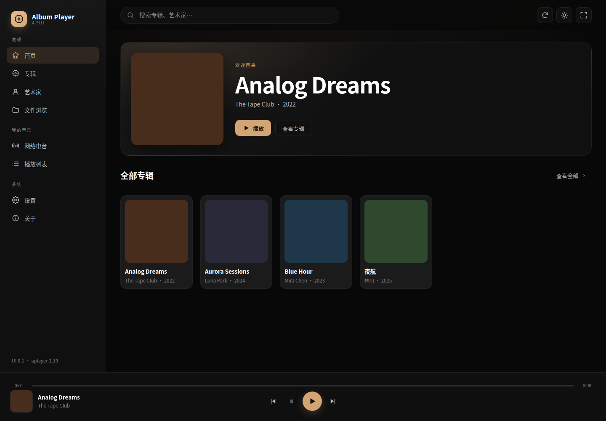
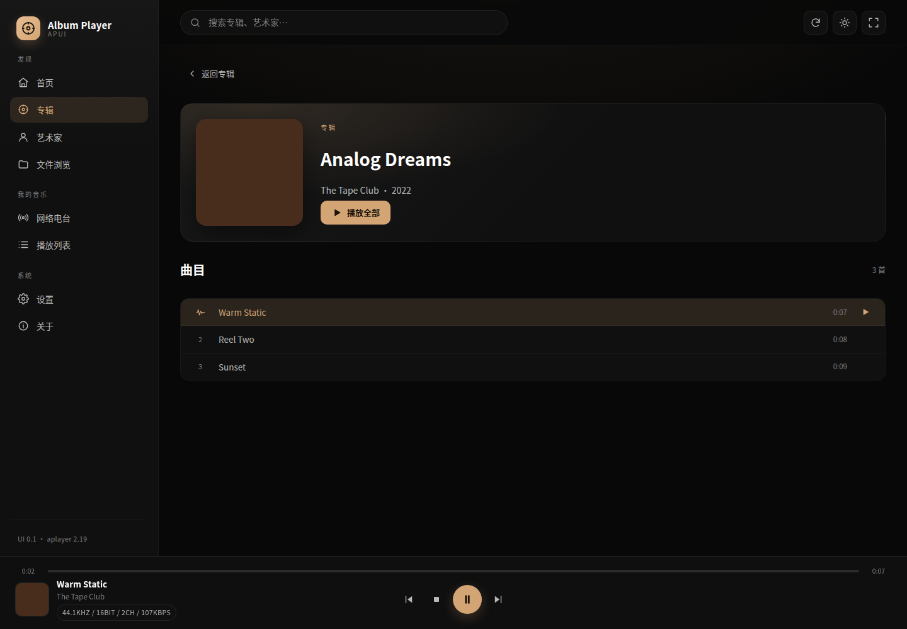
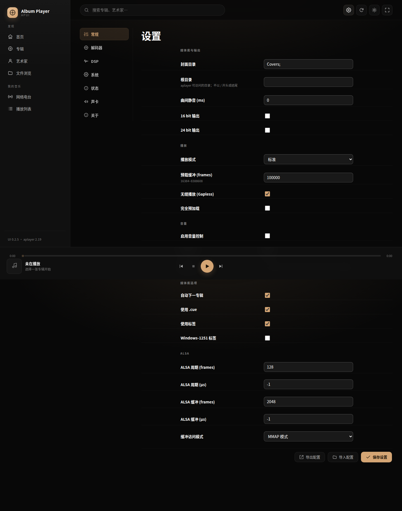
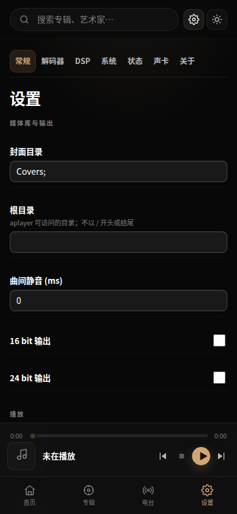
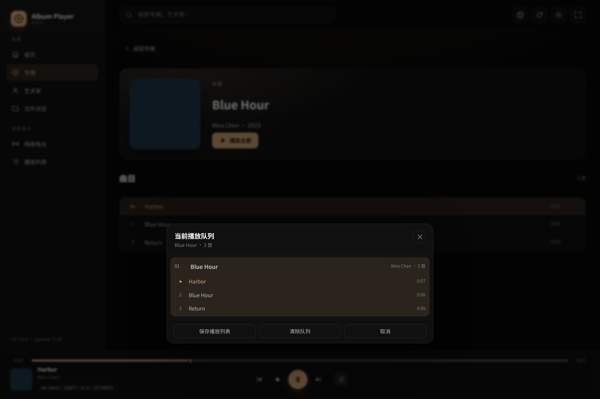
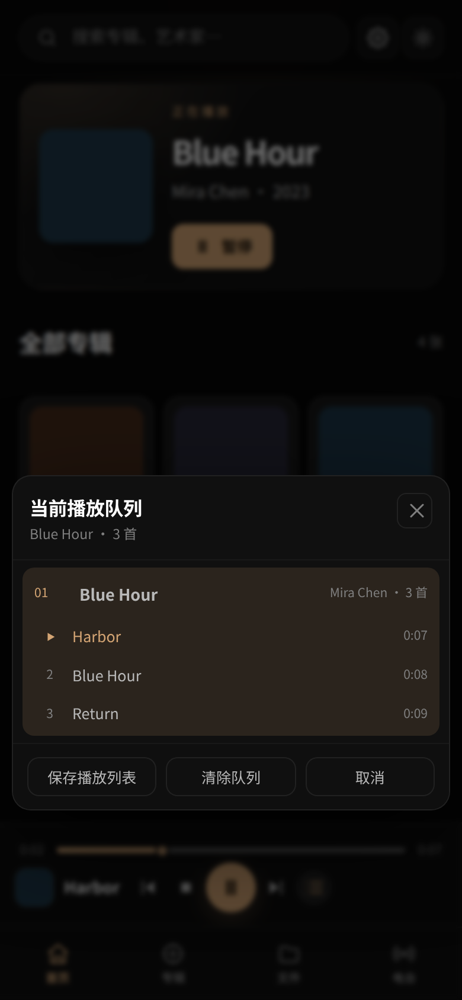

# Album Player UI（APUI）

GitHub: <https://github.com/harmonyosnews/album-player-ui>

**APUI 0.2.20 已实现并部署。** 这是一个与 aplayer 同源的静态 SPA，替换 `/opt/aplayer/aplayer.html` 后由 aplayer 在 **7778** 端口提供；不新增服务/端口，不改音频引擎。

- 构建：Vite 7 + TypeScript；JS 77.1 KB（gzip 24.0 KB）、CSS 35.4 KB（gzip 7.4 KB）。
- 发布包：[release/apui-web-0.2.20.tar.gz](release/apui-web-0.2.20.tar.gz)（47 KB），sha256 `14d79f461c55dfdf8818f08de6bbe0f35b5aa7935763225533c2dee69d6bab40`（`sha256sum -c SHA256SUMS`）。
- 已验证：`.133`（x86 构建/联调）、`.230`（ARM 冒烟）、`.137`（Gentooplayer 实机 45 张专辑曲库、当前队列、真实 FLAC 44.1/16/2 播放）。
- 验收记录：[docs/06-实施与验收记录.md](docs/06-实施与验收记录.md)。

---

## 功能

- 首页/正在播放、专辑/曲目/艺术家、全屏播放、底部播放条。
- 首页始终载入配置的根目录曲库；不再把上一次的当前播放列表当作首页。
- 播放条“当前播放队列”：按专辑展开曲目、当前曲目高亮、保存为 aplayer 播放列表、取消/Esc 关闭。
- 搜索、浅色/深色主题、移动端底部导航。
- 左侧导航仅保留“发现/我的音乐”；设置入口在右上角齿轮；独立“关于”页已合并到设置 About。
- 网络电台：点击左侧入口直接进入；离开自动恢复本地模式；电台数据与本地专辑完全分离。
- 播放列表：仅显示 aplayer 保存的 `aplayer.dat`/`.ap2`，不使用文件浏览；文件浏览独立保留。
- 设置：右上角齿轮进入；左侧无“系统/关于”；7 个主分页 + 常规 5 个子标签 + Decoder/DSP 子分页；参数中文化；底部单一操作行（导出/导入/保存），导入导出为完整配置。
- 离线提示、轮询退避、XSS 消毒、危险操作确认。

**不做**：队列编辑/重排、历史、歌词、标签、智能推荐、多房间、UPnP 7779（aplayer 无对应接口或超范围）。

---

## 界面截图

| 首页 | 播放 | 设置 | 移动端 |
|---|---|---|---|
|  |  |  |  |

| 当前播放队列 | 移动端队列 |
|---|---|
|  |  |

更多截图见 [docs/screenshots](docs/screenshots)。

## 文档索引

| 文档 | 内容 |
|---|---|
| [APUI 使用手册（PDF，0.2.7）](docs/APUI-0.2.7-使用手册.pdf) | 面向使用者的安装、播放、当前队列、电台、播放列表、设置、移动端与排障手册；0.2.8–0.2.20 为设置/界面样式调整、播放修复、队列与英雄页调整 |
| [00-可行性分析.md](docs/00-可行性分析.md) | 现状、接口证据、方案比较、功能覆盖、风险、Go/No-Go |
| [01-实施方案.md](docs/01-实施方案.md) | 架构、技术选型、WBS、阶段计划、构建/部署、测试、回滚 |
| [02-项目书.md](docs/02-项目书.md) | 目标/范围、用户故事、需求规格、页面清单、组织/预算/风险/验收 |
| [03-开发手册.md](docs/03-开发手册.md) | 环境、构建、代码结构、API 客户端、配置安全、UI/测试/发布 |
| [04-程序接口文档.md](docs/04-程序接口文档.md) | aplayer 原生 HTTP 接口、101 个配置字段、错误/怪癖、前端适配层、二期 API |
| [05-实测证据与复现.md](docs/05-实测证据与复现.md) | 三台机器、HTTP 样本、静态白名单、配置回滚、tinylms 分析 |
| [06-实施与验收记录.md](docs/06-实施与验收记录.md) | 实现范围、部署路径、GUI/实机验收、已知问题、回滚 |

---

## 许可与法律

- **代码许可证：Apache License 2.0** — [LICENSE](LICENSE)。
- **版权人：Copyright 2026 harmonyosnews**。
- 归属/第三方声明：[NOTICE](NOTICE)、[THIRD-PARTY-NOTICES.md](THIRD-PARTY-NOTICES.md)。
- 使用前请阅读：[USER-AGREEMENT.md](USER-AGREEMENT.md) 与 [DISCLAIMER.md](DISCLAIMER.md)。
- APUI 发布包不包含 aplayer 二进制、TinyLMS 代码/资源或第三方专辑封面/电台图片；aplayer/TinyLMS 的权利归其各自权利人。
- 用户协议/免责声明是项目交付模板，不构成法律意见；正式对外发布前应由交付方/法务补充主体信息并审阅。

## 快速开始

### 构建

```bash
export PATH=/opt/node22/bin:$PATH   # .133 上 Node 在 /opt
cd web
npm ci
npm run build
npm run check
npm run package                     # 生成 release/apui-web-0.2.20.tar.gz
```

### 安装（热替换，无需重启 aplayer）

```bash
tar -xzf apui-web-0.2.20.tar.gz
cd apui-web-0.2.20
./install.sh /opt/aplayer
# 浏览器打开 http://<player>:7778/
```

安装脚本会备份原 `aplayer.html/js/css` 与 `config.dat` 到 `/opt/aplayer-ui-backup-<时间戳>/`，然后原子替换入口。

### 回滚

```bash
./uninstall.sh /opt/aplayer-ui-backup-<时间戳> /opt/aplayer
```

已实测：`.133` 恢复厂商 UI 后可正常回装 APUI；热替换不需要重启 aplayer。

### 配置媒体库

设置 → 常规 → 音乐根目录，填写 aplayer 可访问的目录（不带首尾 `/`，例如 `opt/aplayer/music` 或 `mnt/samba/Test`）。保存后刷新；UI 在初始化/回到首页时会自动 `GetPlaylists` → `GetPlaylist` 载入该目录，确保首页展示整个曲库。

---

## 目录结构

```
.
├── web/                          # 前端源码/构建/安装脚本
│   ├── src/                      # api/store/ui/views/styles.css
│   ├── scripts/                  # postbuild/check-dist/gui-*.mjs
│   ├── install.sh / uninstall.sh
│   ├── dist/                     # 构建产物
│   └── package.json
├── release/                      # 发布包 + sha256
├── fixtures/aplayer/             # .133 抓取的真实接口样本
├── gui-test-screenshots/         # 桌面/移动/实机截图
├── docs/                         # 七份文档
├── tools/fetch_remote.py         # 现场取证工具
└── work/                         # 现场原始文件（仅证据，不发布）
```

> `work/` 包含厂商前端/资源，不要打进发布包或对外再分发。

---

## 关键 API 事实（实测）

- `GetAlbums` 是**当前播放列表**视图；需先 `GetPlaylists`/`GetPlaylist` 载入目录，否则可能为空。
- `GetAlbums.Songs` 只含当前专辑；其它专辑用 `GetSongs&album=N`，并包含 `SongsLen`（ms）。
- `GetPlaylists&ind=N` 是展开/折叠**切换**，不是单向展开。
- `GetImage` 会重复发送 `Content-Type`（JSON + image），浏览器 `` 可用。
- `SetConfig` 是**整包覆盖**：必须 `GetConfig` → 合并完整可写字段 → POST → 再校验。
- aplayer 会话后可能回写 `config.dat`；测试/部署前备份。
- 静态白名单：`.html/.js/.css/.json/.png`；`.svg/.woff*/.ttf/.webp/.mjs/.map/.txt` 404。
- 无 CORS、无鉴权；`OPTIONS` 501；仅同源部署、可信 LAN。

---

## 重要限制

- 接口来自随包前端 + 实测，不是厂商承诺；aplayer 升级前必须回归。
- `.137` 已验证真实 FLAC 播放；**DSD、声卡切换、电台/播放列表增删的 GUI 验收尚未完成**。
- `.133` 是虚拟机（Ensoniq AudioPCI 虚拟声卡），只用于构建/UI 联调，不作为真机/DSD 验收。
- `.230` 当前声卡不可用；仅做静态资源/UI 冒烟。
- 仅可信 LAN；无登录；不要把 7778 暴露到公网。
- 发布前建议在 `.137` 维护窗口执行 [06-实施与验收记录.md](docs/06-实施与验收记录.md) §7 检查表。

---

## 后续

1. `.137` DSD/声卡/电台增删/播放列表增删验收。
2. Firefox/Safari、iOS/Android 真机验证。
3. 配置导入/导出 GUI 验收。
4. 根据实际音乐目录更新 `.133` 测试库。
5. 厂商 aplayer 升级后重跑 `install.sh` 与契约回归。

---

## 变更记录

| 版本 | 日期 | 变更 |
|---|---|---|
| 0.2.13 | 2026-10-29 | 修复播放中刷新浏览器会停止播放；播放期间不重载根目录，停止后延迟恢复 |
| 0.2.12 | 2026-10-29 | 常规页拆为 5 个子标签（媒体库与输出/播放/音量/媒体库选项/ALSA）；三机部署 |
| 0.2.11 | 2026-10-29 | 设置页统一圆角卡片、内容左对齐；声卡页拆为“声卡/Scream 桥”两卡；三机部署 |
| 0.2.10 | 2026-10-29 | 设置页分组标题 17px/700；声卡“应用”按钮移到选择框右侧；三机部署 |
| 0.2.9 | 2026-10-29 | 设置页分组标题 15px（设置项 13.5px）；三机部署 |
| 0.2.8 | 2026-10-29 | 压缩设置页条目行距（常规行约 43px、开关行约 31px）；三机部署 |
| 0.2.7 | 2026-10-29 | 首页始终载入根目录曲库；播放栏新增当前播放队列（按专辑展开、保存为播放列表、Esc/取消关闭）；三机部署 |
| 0.2.6 | 2026-10-29 | 电台直接进入/离开自动退出、独立电台数据；播放列表只显示 aplayer 列表；三机部署 |
| 0.2.5 | 2026-10-29 | 移动端设置排布/开关行/控件全宽优化；顶部图标收紧 |
| 0.2.3 | 2026-10-29 | 底部操作合并一行、整包导入导出说明、播放进度条可见性修复；三机部署 |
| 0.2.2 | 2026-10-29 | 设置页收窄居中、行距压缩、字体加粗、输入框可见性提升 |
| 0.2.1 | 2026-10-29 | 左侧移除系统分栏；右上角设置入口；关于合并进设置；设置参数中文化；发布包 0.2.1 |
| 0.2.0 | 2026-10-29 | 设置页按官方 7 主分页 + Decoder/DSP 子分页重构；补齐 General/DSD/DVD-A/Radio/DSP/System/Card 参数 |
| 0.1.0 | 2026-10-29 | 首个可部署 MVP；三机部署；`.137` 实机播放通过；发布包/文档 |
| v1.0 文档 | 2026-10-29 | 可行性/方案/项目书/开发手册/接口/证据 |
